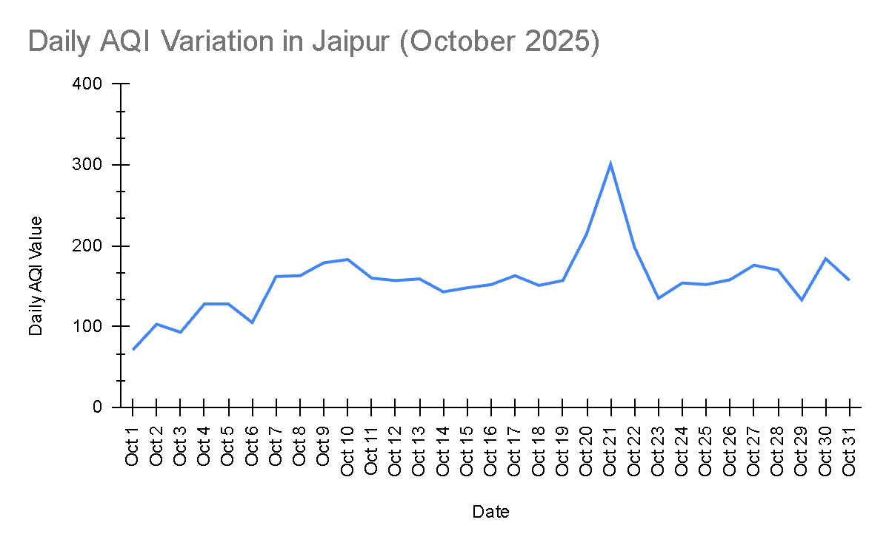

# AQI Shockwave Analysis

**From a manual Excel case study to an automated Python pipeline: measuring how Diwali shocks air quality.**


---

## Overview

In October 2025, I completed a case study on Air Quality Index (AQI) using Excel. I calculated descriptive statistics (mean, median, mode, standard deviation and more) and built two graphs. The finding was clear: air quality stayed in a **normal range for most of the month, then spiked sharply around Diwali**.

That study was entirely manual: formulas in a spreadsheet, screenshots in a report.

A year later, this project revisits it and turns it into an **automated, reproducible pipeline** that:

1. **Validates** the original 2025 Excel results programmatically.
2. **Isolates the event window** (the "shockwave") around Diwali in the historical data.
3. **Applies the same method to a new, live 2026 event**, fetching fresh data and generating outputs automatically.

| | 2025 Case Study | 2026 Pipeline |
|---|---|---|
| Tooling | Excel | Python |
| Process | Manual formulas | Automated scripts |
| Output | Screenshots + 2 graphs | CSV logs + PNG charts |
| Data | Oct 2025 | Oct 2025 (validated) + live 2026 |

---

## Key Finding

AQI remained largely in the normal range through October 2025, followed by a **sharp surge during the Diwali period**. The Python pipeline independently reproduced the original Excel statistics (mean, median, mode, SD), confirming the 2025 results were accurate.



---

## Repository Structure

```
aqi-shockwave-analysis/
│
├── pipeline/                       # Three-stage modular Python engine
│   ├── validation_2025.py          # Stage 1: Audits Oct 2025 Excel stats
│   ├── event_comparator.py         # Stage 2: Slices data into T-10 to T+5 windows
│   └── live_pipeline.py            # Stage 3: Fetches live data, models T-10 to T+10
│
├── AQI_Data/                       # Data boundary
│   ├── oct_2025_case_study.xlsx    # Ground-truth dataset from the 2025 manual study
│   └── [generated outputs]         # CSV logs and PNG charts from live_pipeline.py
│
├── assets/                         # Visual documentation
│   ├──  Average.png
│   ├──  Bar Graph.png
│   ├──  Line Graph.png
│   ├──  Max-Min.png
│   ├──  Max.png
│   ├──  Median.png
│   ├──  Min.png
│   ├──  Mode.png
│   ├──  Oct2025.png
│   ├──  Range.png
│   ├──  Standard Deviation.png
│   └──  Summary.png
│
├── .gitignore                      # Ignores runtime outputs, keeps seed data
├── LICENSE                         # MIT License
└── README.md
```

---

## The Pipeline

### Stage 1: `validation_2025.py` (Validate)
Reads the original Excel dataset and recomputes the descriptive statistics from the 2025 case study: **mean, median, mode, and standard deviation**. It then compares them against the manually calculated values to confirm the original work was correct.

**Result:** All values matched the original Excel calculations.

### Stage 2: `event_comparator.py` (Compare)
Takes the path of a selected dataset (here, the 2025 Excel file) and slices it into an **event window from T-10 to T+5**, where **T = the event day (Diwali)**. This isolates the pre-event baseline and the post-event aftermath, so the "shockwave" is easy to see.

### Stage 3: `live_pipeline.py` (Automate)
Fetches data from a live source, processes it, and models an **extended T-10 to T+10 window** for the 2026 event. It then exports:
- a **CSV** of the processed window, and
- a **graph** of the AQI trend,

both saved to the `AQI_Data/` folder.

---

## Getting Started

### Prerequisites

- Python 3.8+
- Required libraries (adjust to match your imports):

```bash
pip install pandas numpy matplotlib openpyxl requests
```

### Installation

```bash
git clone https://github.com/AryanPaste/AQI-Shockwave-Analysis.git
cd aqi-shockwave-analysis
pip install -r requirements.txt
```

### Usage

Run the stages in order from the project root:

```bash
# Stage 1: Validate the 2025 Excel statistics
python pipeline/validation_2025.py

# Stage 2: Generate the T-10 to T+5 comparison window
python pipeline/event_comparator.py

# Stage 3: Fetch live data and generate outputs
python pipeline/live_pipeline.py
```

Generated CSV files and charts will appear in `AQI_Data/`.

---

## Methodology

- **T-notation:** `T` is the event day. `T-10` is ten days before and `T+5` / `T+10` are days after, giving a baseline-to-aftermath view.
- **Statistics used:** mean, median, mode, standard deviation.
- **Validation approach:** independent recomputation in Python, compared against the Excel formulas from the original study.

---

## Why This Project

This project demonstrates the shift from **manual spreadsheet analysis** to **reproducible, automated data workflows**: same question, stronger method. It shows:

- Auditing past work for correctness
- Modular pipeline design
- Extending a one-time study into a repeatable process

---

## Roadmap

- [ ] Add more event comparisons (other festivals or seasons)
- [ ] Add additional pollutants (PM2.5, PM10)
- [ ] Schedule `live_pipeline.py` for automatic runs

---

## License

Distributed under the MIT License. See [`LICENSE`](LICENSE) for details.

## Author

**Aryan Paste** ·
[GitHub](https://github.com/AryanPaste) · [LinkedIn](https://www.linkedin.com/in/aryanpaste/)
